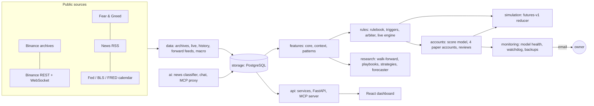

# QuantPilot BTC

**A research and paper-trading platform for Bitcoin perpetual futures. It collects market data around the clock, runs a rule-based trading engine and four paper accounts live, monitors its own models, and reports every result honestly, including the negative ones.**

> **Paper trading only.** QuantPilot has no exchange order endpoints and no trading keys, and it cannot place a real order. Write endpoints answer only on the local machine. This is a research project, not financial advice.

## What it does

| Area | What's built |
|---|---|
| **Data** | 5-minute BTCUSDT perpetual candles (5 years, 525,888 bars, zero gaps at audit), funding, open interest, long/short ratios, taker flow, Fear & Greed, order-book depth and liquidations (forward-only), the US macro release calendar and RSS news. Everything is stored in PostgreSQL with provenance and checksums. |
| **Features** | ~100 causal features at the completed-bar cutoff, plus a multi-timeframe market context: EMA stacks, ADX, RSI, ATR, VWAP ±2σ, squeezes, 4h 80% volatility bands, support/resistance with sweeps, breaks and retests, and OI/price states. |
| **Rule engine** | A YAML rulebook of 20 playbooks (flush rebounds, breakout retests, squeezes, trend pullbacks, range fades, post-release breakouts and more). An arbiter turns triggers into at most one action. Gates cover macro blackouts, liquidation cascades and thin books. Every trigger, setup, skip and trade is journaled. |
| **Paper accounts** | Four $10,000 futures accounts (Careful → Aggressive) take setups above score cutoffs from a frozen logistic model. Each pauses after 30 trades for an owner review written with Claude; the accounts never change their own rules. |
| **Simulation** | One pure reducer for backtests and forward paper (`futures-v1`), with fees, slippage, funding, liquidation price checks, break-even moves and time stops. |
| **Research** | Purged walk-forward evaluation, triple-barrier labels, meta-labeling, PBO and deflated Sharpe, a contextual-bandit learner and trade-management RL (tabular Q, PPO). All pre-registered, with a one-year holdout kept untouched. |
| **MLOps** | Model health: live calibration (Wilson bounds), PSI drift against development windows, an input data check that holds back suspect setups, a model card, and a shadow challenger that is never auto-swapped. |
| **AI** | News classification and an in-app chat through the owner's Claude subscription (`claude -p`, sandboxed; API keys are stripped). The chat uses only read-only tools, served through MCP. |
| **Ops** | A watchdog (Task Scheduler, every 5 minutes) that restarts stuck services with a restart budget, Gmail alerts, nightly verified `pg_dump` backups with an off-site copy, and a tested restore. |
| **Interfaces** | FastAPI (36 routes), an MCP server (17 read-only tools), and a React + TypeScript dashboard with 8 views: overview, chart with 86 studies, ask, research, rules, paper accounts, news and system. |

## Architecture



A **data supervisor** runs the long-lived loops in separate threads: candles, news, macro, the rule engine, account reviews, forecasts and forward research data. The **API** process serves the dashboard and MCP. Both are started by `scripts/start.cjs` and kept alive by the watchdog.

## Results so far (honest)

| Question | Answer |
|---|---|
| Can direction be predicted at 1h / 4h / 24h? | **No.** No feature group or model beat the base rate after purged walk-forward evaluation. |
| What does work? | 1h/4h **return ranges** and 24h **volatility** (EWMA/GARCH) have validated skill. |
| Selective strategies (186 pre-registered configurations) | **None passed** the gate (PBO, deflated Sharpe, Wilson bound above break-even). The holdout year stays untouched. |
| Rulebook v2 on development data | 180 trades, **−10.1%**: 31.7% win rate against a 45.4% break-even. No playbook passed. |
| Paper accounts | Live since 2026-10-23. In development they are expected to lose slightly (−0.11R to −0.15R per trade), so they run to **collect evidence**, not as a money-maker. |

Every new idea needs a dated amendment in [`docs/research/preregistration.md`](docs/research/preregistration.md) before it is tested. Results are reported whether they pass or fail.

## Project layout

```
src/quantpilot/
├── cli.py, config.py        command line entry point and settings
├── storage/                 database, market history, backups, snapshots
├── data/                    archives, live REST, history backfill, forward feeds, repair, panels, macro calendar
├── features/                causal features, market context, rule-engine patterns, chart studies
├── simulation/              event reducer, futures-v1 simulator, trade plans, outcomes, benchmark, paper worker
├── rules/                   rulebook, triggers, arbiter, live engine, journal, ML/news/learner/RL layers
├── accounts/                account config, score model, live fan-out, journal, reports, 30-trade reviews
├── research/                walk-forward, events, selective strategies, playbooks, agent study, forecaster
├── monitoring/              model health, watchdog and backups, operations evidence, readiness checks
├── ai/                      news ingestion and classification, news events, chat, MCP proxy
├── outlook/                 market questions, validated answers, analogs, answer scoring
└── api/                     shared read services, FastAPI app, MCP server
tests/                       pytest suite, mirroring the package layout
frontend/src/                React dashboard: app/, pages/, components/, lib/, styles/
frontend/tests/              Playwright browser tests
rulebook/                    rulebook v1/v2 (YAML + Excel) and the paper-account config
migrations/                  Alembic migrations
scripts/                     start.cjs, plus ops/, verify/ and release/
docs/                        architecture, rule engine, research, operations, verification, design records
```

## Tech stack

Python 3.11, FastAPI, SQLAlchemy and Alembic, PostgreSQL, pandas and NumPy, scikit-learn, XGBoost, SHAP, stable-baselines3 and Gymnasium, MCP SDK, React 19, TypeScript, Vite, Tailwind, lightweight-charts, Recharts, Playwright, pytest, GitHub Actions and Docker.

## Getting started

Requires Python 3.11, Node 22 and PostgreSQL 18 (the Windows launcher uses its binaries).

```powershell
uv sync --locked --extra dev
npm --prefix frontend ci
node scripts/start.cjs          # PostgreSQL, API (127.0.0.1:8000), dashboard (localhost:5173), data supervisor
node scripts/start.cjs --check  # readiness without restarting anything
```

On first run the launcher creates a private PostgreSQL cluster on port 55432 and writes a git-ignored `.env`; see [`.env.example`](.env.example) for the settings. Optional e-mail alerts and the watchdog/backup tasks are described in [operations](docs/operations/operations.md).

Data and trained models are not in the repository. A fresh checkout acquires history with `quantpilot backfill-history` and trains with the research commands in [docs/rule-engine.md](docs/rule-engine.md). Missing inputs produce explicit blocked states, never made-up numbers.

## Tests

```powershell
uv run pytest -q                              # ~500 Python tests, including leakage canaries
npm --prefix frontend run build
npm --prefix frontend test                    # Playwright browser tests
node scripts/verify/check-structure.cjs       # static repository checks
```

## Documentation

- [Architecture](docs/architecture.md) and the [rule engine](docs/rule-engine.md)
- Research:
  - [pre-registration](docs/research/preregistration.md)
  - [strategy research](docs/research/strategy-research.md)
  - [forecast research](docs/research/forecast-research.md)
  - [model card](docs/research/model-card.md)
- Operations:
  - [watchdog, alerts and backups](docs/operations/operations.md)
  - [recovery](docs/operations/recovery.md)
  - [MCP setup](docs/operations/mcp-setup.md)
- [Design records](docs/design/) and the [project log](docs/project-log.md)

[THIRD_PARTY_NOTICES.md](THIRD_PARTY_NOTICES.md) lists data-source terms and attributions.
