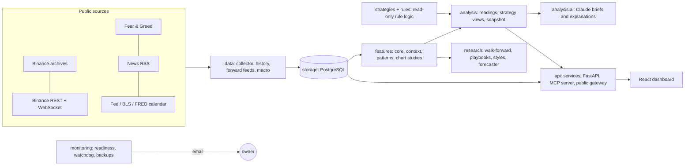

# QuantPilot BTC

**A Bitcoin analysis app. It collects market data around the clock, reads about 30 indicators and every strategy on completed candles, explains what they say in plain words, and has Claude write market briefs and on-demand explanations. Every research result is reported honestly, including the negative ones.**

> **Nothing here trades.** QuantPilot has no exchange order endpoints and no trading keys. Paper trading was removed on 2026-11-02 (amendment A15) because no strategy proved an edge after costs; the research behind that decision is kept. Write endpoints answer only on the local machine. This is a research project, not financial advice.

## What it does

| Area | What's built |
|---|---|
| **Data** | 5-minute BTCUSDT perpetual candles (5 years, no gaps at audit), funding, open interest, long/short ratios, taker flow, Fear & Greed, order-book depth and liquidations (recorded live), the US macro calendar and RSS news. Stored in PostgreSQL with provenance. |
| **Indicators** | A library of about 30 indicators (trend, momentum, volatility, volume and flow, levels, positioning) with plain meanings and reading zones, read on 15m, 1h, 4h and daily candles. The chart has 86 studies. |
| **Strategies** | Trend Rider, Range Trader, Breakout Hunter, Funding Collector, the trend-led master logic and the 13-playbook rulebook, each shown as a live checklist with its history-test result. Read-outs only. |
| **Claude** | Market briefs every 4 hours (Haiku) and "Explain this" on any indicator, strategy, news item or chart view (Sonnet), on the owner's subscription (`claude -p`, sandboxed, API keys stripped). An in-app chat uses read-only MCP tools. |
| **Research** | Purged walk-forward evaluation, triple-barrier labels, meta-labeling, PBO and deflated Sharpe, pre-registered strategy and playbook studies, a bandit learner and trade-management RL, and shadow forecasts scored forward. A one-year holdout stays untouched. |
| **Ops** | A watchdog (every 5 minutes) that restarts stuck services with a restart budget, Gmail alerts, nightly verified `pg_dump` backups with an off-site copy, and a read-only public view. |
| **Interfaces** | FastAPI (31 routes), an MCP server (13 read-only tools), and a phone-first React dashboard: Home, Indicators, Strategies, Chart, and News, Ask, Research, Trading history and System under More. |

## Architecture



A **data supervisor** (`scripts/ops/data_supervisor.py`) runs one thread per job: the candle collector, history backfill, news, macro calendar, live liquidations and order book, shadow forecasts, the outlook, and the analysis snapshot with Claude's brief (every 5 minutes). The **API** serves the dashboard and MCP. Both are started by `scripts/start.cjs` and kept alive by the watchdog.

## Results so far (honest)

| Question | Answer |
|---|---|
| Can direction be predicted at 1h / 4h / 24h? | **No.** No feature group or model beat the base rate after purged walk-forward evaluation. |
| What does work? | 1h/4h **return ranges** and 24h **volatility** (EWMA/GARCH). The 4h likely range is shown on Home and in the indicators. |
| Selective strategies (186 pre-registered configurations) | **None passed** the gate (PBO, deflated Sharpe, Wilson bound above break-even). |
| Rulebook v2 on development data | 180 trades, **−10.1%**: 31.7% win rate against a 45.4% break-even. |
| Trading styles (2021–2025) | Trend Rider +28.6% and Funding Collector +13.9% (positive, not proven); Range Trader and Breakout Hunter −50%; the trend-led master +1.6% (post-hoc). Holding BTC beat them all. |

Every new idea needs a dated amendment in [`docs/research/preregistration.md`](docs/research/preregistration.md) before it is tested.

## Project layout

```
src/quantpilot/
├── cli.py, config.py        command line entry point and settings
├── analysis/                indicator catalogue, readings, strategy views, snapshot, Claude briefs and explanations
├── features/                causal features, market context, patterns, chart studies
├── strategies/              the trading styles' rules (read-only views and research)
├── rules/                   rulebook, triggers, arbiter, archived journal, research layers (ML, learner, RL)
├── research/                walk-forward, events, strategies, playbooks, style tests, forecaster
├── simulation/              futures-v1 simulator, trade plans, outcomes, benchmarks (research only)
├── data/                    archives, collector, history backfill, forward feeds, repair, panels, macro calendar
├── storage/                 database, market history, backups and recovery
├── monitoring/              readiness, watchdog checks, backups, process helpers
├── ai/                      news analysis, chat, MCP proxy, outlook explanations
├── outlook/                 market questions, validated answers, analogs, answer scoring
└── api/                     shared read services, FastAPI app, MCP server, public gateway
tests/                       pytest suite, mirroring the package layout
frontend/src/                React dashboard: app/, pages/, components/, lib/, styles/
frontend/tests/              Playwright browser tests
rulebook/                    rulebook v1/v2 (YAML + Excel)
scripts/                     start.cjs, plus ops/ and verify/
docs/                        analysis app, architecture, rule engine, research, operations, design records
```

## Tech stack

Python 3.11, FastAPI, SQLAlchemy and Alembic, PostgreSQL, pandas and NumPy, scikit-learn, XGBoost, stable-baselines3 and Gymnasium (research), MCP SDK, Claude Code CLI, React 19, TypeScript, Vite, Tailwind, lightweight-charts, Recharts, Playwright and pytest.

## Getting started

Requires Python 3.11, Node 22 and PostgreSQL 18 (the Windows launcher uses its binaries).

```powershell
uv sync --locked --extra dev
npm --prefix frontend ci
node scripts/start.cjs          # PostgreSQL, API (127.0.0.1:8000), dashboard (localhost:5173), data supervisor
node scripts/start.cjs --check  # readiness without restarting anything
node scripts/stop.cjs           # stop everything (the watchdog and nightly backup pause until the next start)
```

On first run the launcher creates a private PostgreSQL cluster on port 55432 and writes a git-ignored `.env`; see [`.env.example`](.env.example). The watchdog, backups and alerts are described in [operations](docs/operations/operations.md).

Market data is not in the repository. A fresh checkout acquires history with `quantpilot backfill-history`. Missing inputs produce explicit empty states, never made-up numbers.

## Tests

```powershell
uv run pytest -q                              # Python tests, including look-ahead canaries
npm --prefix frontend run build
npm --prefix frontend test                    # Playwright browser tests
node scripts/verify/check-structure.cjs       # static repository checks
```

## Documentation

- [The analysis app](docs/analysis-app.md), the [architecture](docs/architecture.md) and the [rule engine](docs/rule-engine.md)
- Research: [pre-registration](docs/research/preregistration.md), [strategy research](docs/research/strategy-research.md), [style research](docs/research/style-research.md), [forecast research](docs/research/forecast-research.md), [model card](docs/research/model-card.md)
- Operations: [watchdog, alerts and backups](docs/operations/operations.md), [recovery](docs/operations/recovery.md), [MCP setup](docs/operations/mcp-setup.md)
- [Design records](docs/design/) and the [project log](docs/project-log.md)

[THIRD_PARTY_NOTICES.md](THIRD_PARTY_NOTICES.md) lists data-source terms and attributions.
