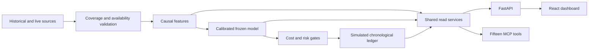

# QuantPilot BTC

Bitcoin research with technical indicators, derivatives positioning, daily sentiment, calibrated ML, simulated perpetual-futures accounting source-linked news analysis and sixteen MCP tools (read-only apart from logging outlook answers).

**PostgreSQL chart workspace:** open [localhost:5173/#chart](http://localhost:5173/#chart). **BTCUSDT is the only active symbol**, backed by Binance USD-M perpetual data for consistent chart, prediction and paper accounting. The native workspace offers 86 selectable studies, seven timeframes and saved drawing tools, with an optional official TradingView hosted chart. Actual provider price changes have been verified through PostgreSQL onto the chart. The five-year perpetual candle audit contains 525,888 observations with zero gaps at its recorded cutoff. Previously imported spot/reference records are retained as inactive archives; they are not merged into BTCUSDT or synchronized by the updated collector. See [market setup and exact status](docs/market-platform.md). Run `node scripts/start.cjs --restart-services` once from your regular network-enabled terminal to activate this update in already-running services; subsequent starts use `node scripts/start.cjs`.

**Local readiness verification:** 272 Python tests and 22 browser tests (2 skipped) pass on 2026-10-20, with the production build; the release-era evidence below recorded 88 Python tests, 14 browser tests and seven real PostgreSQL integration checks. Seven additional Node cases check startup readiness. The launcher now distinguishes a responding API from full operational readiness; `node scripts/start.cjs --check` inspects existing services without restarting them. Persistent monitoring, readiness endpoints and fixed UTC scheduling are implemented. The entry JavaScript is about 439 kB with no oversized-chunk advisory. See [current completion evidence](docs/evidence/local-completion-verification.json), [the refreshed two-minute walkthrough](docs/walkthrough.md) and [operations/activation](docs/operations.md).

**Actual local operation:** the latest read-only check records a connected five-second collector and 36 forward decisions over about 8.88 hours, with zero fills. The new monitor still needs the already-running API/supervisor reloaded from the regular terminal: `node scripts/start.cjs --restart-services`. Readiness stays blocked until instrumentation starts. This observation span is not an uptime percentage. Public hosting is deferred.

**Fast live chart:** BTCUSDT candles update incrementally through the exchange WebSocket, with reconnect and PostgreSQL fallback. The agent-controlled browser's provider WebSocket is blocked by network policy; actual stream latency remains unverified here. A separate actual-database sample observed four saved snapshots at a median interval of 5.638 seconds, with median local API request time of 159.5 ms. These are save intervals rather than exchange latency. See [live-data behavior](docs/live-data.md) and [sample evidence](docs/evidence/persistence-runtime.json).

**Frozen research release: `24c8238525d4`.** The experiment below and the nine original read-only MCP tools remain available (`get_news_events`, `get_macro_calendar` and `get_shadow_forecasts` were added later). Original release evidence is preserved separately from later storage, chart and operational work.

**Local recovery verified:** the full PostgreSQL backup restores seven tables and 3,639,242 rows in an isolated drill. Use `uv run quantpilot doctor` for current readiness and see [backup/recovery commands](docs/recovery.md). [Latest doctor evidence](docs/evidence/local-doctor.json) retains its actual check time; earlier runtime reports remain historical snapshots.

## Measured results

| Evidence | Result |
|---|---|
| Research period | October 2024 through September 2026, plus 40 days of warm-up |
| Acquisition | 874 checksum-verified Binance archives plus two daily recovery archives; historical Alternative.me sentiment |
| Common eligible observations | 209,983 five-minute cutoffs across all 24 months |
| Feature catalogue | 106 columns; training-only selection up to 40 inputs |
| Evaluation | 14 expanding monthly folds per group; constant/logistic/XGBoost candidates; calibration and 60-minute purges |
| Untouched holdout | August and September 2026 |
| Full-group model | Calibrated XGBoost; ROC-AUC 0.5388, Brier 0.2511, balanced accuracy 50.65% |
| Frozen holdout policy | Zero trades; 0% return and drawdown under modeled costs/risk |
| Frozen replay | Exactly matches the original full-group trading result |

Strict completeness is false. The authorized `positioning_quarantine_v1` policy excludes 62 affected positioning rows and dependent feature windows, retaining every family and month without interpolation. The affected fraction is 0.028%, below the policy's 0.1% cap. Exact gaps and exclusions remain visible in the [coverage report](docs/coverage-report.md).

The holdout shows modest directional ranking and no executable strategy trades. These results do not establish profitability. Read the [evaluation report](docs/evaluation-report.md), [model card](docs/model-card.md) and [verification](docs/verification.md).

## Local startup

Requires Python 3.11 and Node 22.

```powershell
uv sync --locked --extra dev
npm --prefix frontend ci
node scripts/start.cjs
```

The launcher configures the private project PostgreSQL instance and starts the API, dashboard and data supervisor in the background. It requires the installed PostgreSQL 18 Windows binaries. On other platforms configure an existing PostgreSQL connection and run the owner services from [the market setup guide](docs/market-platform.md). For the frontend alone:

```powershell
npm --prefix frontend ci
npm --prefix frontend run dev
```

Open [the dashboard](http://localhost:5173) and [API documentation](http://127.0.0.1:8000/docs). Local Parquet and research artifacts are excluded from source control. This workspace contains them; a fresh checkout must acquire data and train, or use the trusted exported model with operational database snapshots. Missing inputs produce explicit blocked states. `/?preview=1` provides a labeled synthetic interface preview.

News: the data supervisor polls the Fed, BLS and CoinDesk feeds every five minutes and, at most once per 15 minutes, sends new items to each configured reasoner: `claude -p` with Claude Sonnet 5.5 (saved claude.ai subscription login) and `codex exec` (saved ChatGPT login). API keys are stripped from both, so nothing falls back to billed APIs. Each reasoner has its own 48-batches/day budget and usage-limit backoff; `QUANTPILOT_NEWS_REASONERS` sets the list and order (the first feeds research features). Claude runs with no tools, MCP servers, hooks, skills or saved session. When the ChatGPT usage limit is reached, analysis pauses for an hour and the dashboard shows it as delayed; missing analysis is never treated as neutral. News results are shadow research and do not change the trading policy. Manual commands: `uv run quantpilot collect-news --once`, `analyze-news`, `news-status`.

Macro calendar: `uv run quantpilot macro-calendar` stores CPI, jobs-report and FOMC schedules from official sources (FRED's release calendar from 2025, earlier BLS dates from the first ALFRED vintage containing each month, the Federal Reserve's FOMC calendar) with first-release values from release-day ALFRED vintages. No consensus forecasts are available, so surprises are never computed. The supervisor refreshes it hourly; `GET /api/v1/macro` and the MCP tool `get_macro_calendar` serve it.

Research (descriptive and experimental only; nothing is released or traded):
- `uv run quantpilot event-study` — five-year hourly study of 5% drops and rallies with matched ordinary controls; results in [docs/event-study.md](docs/event-study.md).
- `uv run quantpilot research-events --output <new dir> --folds 4` — 1h/4h/24h direction, return ranges, large-drop risk and EWMA vs GARCH volatility, on identical walk-forward timestamps.
- Overfitting controls: champions are chosen on validation only (a constant base-rate forecast wins when nothing beats it), test skill is reported with the number of configurations tried, PBO (probability of backtest overfitting) is measured per horizon, and XGBoost uses large leaves plus row/column subsampling. Interrupted runs resume from `progress.jsonl`.
- `uv run quantpilot research-data` then `uv run quantpilot research-strategies --output <new dir>` — pre-registered selective strategy research ([pre-registration](docs/research/preregistration.md), [results](docs/strategy-research.md)): ten rule families and two meta-labeled primaries, intraday and swing, scored as trades (take-profit, stop or time limit) after fees and funding, with walk-forward selection, a trial registry, deflated Sharpe and PBO. Result on 2026-10-20: **no strategy passed**; the holdout year stays untouched. `GET /api/v1/strategy-research`, MCP `get_strategy_research` and the Prediction tab show the verdict. The supervisor also records liquidations and a 1000-level order-book snapshot every minute for tests registered to run from 2027-04-20.
- `uv run quantpilot shadow-forecast` — the dynamic forecaster: refits each horizon's champion daily on recent PostgreSQL history and records 1h/4h/24h probabilities, 80% return ranges, 24h large-drop risk and EWMA/GARCH volatility every 15 minutes (the supervisor runs it). Each forecast is scored when its horizon passes; `GET /api/v1/forecasts`, MCP `get_shadow_forecasts` and the Prediction tab show the forward record. It never trades.

Ask QuantPilot: the dashboard's **Chat** tab, `uv run quantpilot ask "Will BTC go up in the next 4 hours?"`, or Claude Code with the MCP tools ([setup](docs/mcp-setup.md)) answer up/down (1h–7d), "will BTC touch $X by T", expected range, big-move and "why is BTC moving" questions. The quant engine sets every number from methods validated walk-forward (`uv run quantpilot validate-outlook`); unvalidated methods fall back to the base rate labeled *no edge*. Claude (Sonnet, subscription only) explains the answer and logs its own probability; every answer is scored after its horizon on a scoreboard comparing quant, AI and base rate. The chat agent can use only QuantPilot's read-only tools.

Run `uv run quantpilot worker` for one public-feed update or let the supervisor schedule attempts. The existing network-enabled supervisor has recorded forward no-trade decisions; the agent process itself is denied outbound provider sockets. `uv run quantpilot status` shows current readiness and recorded outcomes. Owner commands `pause` and `resume` control entries while exits/reconciliation continue. There is no real-order API.

## Reproduce research

Use a new artifact directory for a new experiment; the existing holdout lock protects frozen results.

```powershell
uv run quantpilot audit --as-of 2026-10-18
# If provider gaps exist, inspect the report and attempt exact-source recovery:
uv run quantpilot repair-data --as-of 2026-10-18
# This bounded positioning policy was authorized for the current release:
uv run quantpilot audit --as-of 2026-10-18 --offline --quarantine-positioning
uv run quantpilot train --as-of 2026-10-18
uv run quantpilot backtest --group full
uv run quantpilot publish-research
uv run python scripts/release/export_release.py
```

Audit/recovery exit nonzero when blocked. Structural/provenance errors and other-family gaps still block the positioning policy. Training rechecks dataset hashes, fits preprocessing/selection on training data, calibrates separately, then freezes model/thresholds before holdout. Never remove mandatory families or backfill historical features with current values.

Historical research stays in local Parquet. Trusted exports in `release/` supply the worker's model/evaluation. Credentials belong in environment secrets. Supabase/PostgreSQL, GitHub scheduling and Render/Vercel configurations await account setup and deployment verification: [runbook](docs/deployment.md).

## Verification

```powershell
uv run pytest -q
npm --prefix frontend run build
cd frontend
npx playwright install chromium
npm test
cd ..
uv run python scripts/release/smoke_release.py
```

The real-data smoke script requires audited local data and a frozen model. The release browser case requires FastAPI on port 8000 and `QUANTPILOT_RELEASE_SMOKE=1`. Set `QUANTPILOT_BROWSER_CHANNEL=chrome` to use installed Chrome. The suite also covers stream chronology/reconnect, on-demand data requests and worker-monitor failure/retry states. The trained-release and PostgreSQL workspace cases require the local API.

`node scripts/verify/verify.cjs` runs all verification stages; `--frontend` runs frontend stages only. Scoped evidence is saved under `.verification/`. [Current verification](docs/evidence/local-readiness-verification.json) includes source and evidence hashes; [frozen research evidence](docs/evidence/release-verification.json) preserves the original experiment. Python requirements have exact versions and hashes; uv/npm locks are checked in. The production build passes with a 439 kB entry chunk; lazy chunks stay below the 500 kB advisory threshold.

## Architecture and interfaces



Four dashboard views: Market, Prediction, Research and Paper portfolio. FastAPI/MCP return structured results with observation time, freshness and model/config identity. Public access is read-only; MCP runs locally over stdio. See [assistant setup](docs/mcp-setup.md).

| Area | Source |
|---|---|
| Acquisition, audit and exact-source recovery | `src/quantpilot/data.py`, `repair.py` |
| Causal catalogue and availability joins | `features.py`, `data.py` |
| Walk-forward training and frozen replay | `research.py`, `replay.py` |
| Shared risk/accounting | `engine.py`, `store.py` |
| Live ingestion/reconciliation/projections | `live.py`, `worker.py`, `snapshots.py` |
| Readiness and persistent run monitoring | `operations.py`, `frontend/src/PaperOperations.tsx` |
| News collection and Codex reasoning (shadow only) | `news.py`, `frontend/src/NewsPanel.tsx` |
| Macro release calendar | `macro.py`, `frontend/src/MacroCalendar.tsx` |
| Event study and multi-horizon research | `event_study.py`, `event_research.py` |
| Shared API/MCP | `services.py`, `api.py`, `mcp_server.py` |
| Dashboard and browser checks | `frontend/` |
| Migrations and CI | `migrations/`, `.github/workflows/` |

## Simulation conventions

Starting equity 10,000 USDT; one position; maximum 25% equity notional; no added borrowing; 0.25% per-trade risk; 1.5 ATR stop; 60-minute maximum hold; 2% daily-loss entry halt. Fees are 5 bps and spread/slippage 3 bps per side, with a 5 bps edge buffer. Weak forecasts, stale/missing inputs and breached limits return explicit no-trade reasons.

Historical entries use the first observed bar opening after cutoff plus execution delay; one-second delay normally means waiting five minutes. Intrabar stop paths are unknown: touched stops and adverse gap fills are conservative approximations. Time exits occur at the next observed event after the deadline. Funding settles at actual timestamps using the last observable mark and enters predictors only after availability.

Simplified isolated margin fully collateralizes notional, uses mark P&L and a 0.5% maintenance approximation with an isolated bankruptcy cap. It does not reproduce Binance's tiered liquidation engine. Replayed events reconcile existing exposure; entries require a current decision and subsequent quote. Transactions, stable event IDs and worker locks protect accounting.

The passive benchmark uses fully collateralized perpetual exposure; the moving-average comparator uses active costs/risk/holding rules. SHAP and coefficients describe model associations. Cumulative signed taker volume is a proxy, not reconstructed tick-level order flow.

[Architecture](docs/architecture.md) | [Data dictionary](docs/data-dictionary.md) | [Acceptance](docs/acceptance.md) | [Walkthrough](docs/walkthrough.md)

## Sources and attribution

[Binance public data](https://github.com/binance/binance-public-data), [Binance market APIs](https://developers.binance.com/en/docs/catalog/core-trading-derivatives-trading-usd-s-m-futures/api/rest-api/market-data), [Alternative.me](https://alternative.me/crypto/fear-and-greed-index/) and the [official MCP Python SDK](https://github.com/modelcontextprotocol/python-sdk/tree/v1.x).

Charts use [TradingView Lightweight Charts](https://www.tradingview.com/lightweight-charts/). This project supplies market data and indicator calculations. See [third-party notices](THIRD_PARTY_NOTICES.md).
