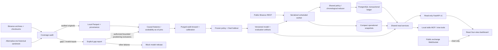

# Architecture

Historical Parquet belongs on the training laptop. Ephemeral GitHub runners maintain a live cache and persist accounting plus read projections to PostgreSQL. Render reads projections from the same database; it does not depend on GitHub's local filesystem. MCP uses the same service layer and can point at the operational database or a local SQLite ledger.

PostgreSQL advisory locks serialize worker processes. Account mutation also takes a transaction-scoped lock and row lock. SQLite uses a local file lock and transaction. Stable provider event IDs deduplicate replays. An out-of-order market event fails instead of modifying prior accounting. Owner controls have a separate timestamp and leave the market reconciliation cursor unchanged, so a pause/resume cannot skip unprocessed accounting. Each ledger record stores input, derived fills/funding/decisions, cash/equity and position after processing.

After downtime, historical market/funding events reconcile existing exposure and receive the replay label. Pending entries are discarded on replay. Fresh entries require a newly generated decision and a subsequent current quote. Insufficient retained history, missing candle intervals, missing marks or stale/gapped settlement history stop reconciliation before applying accounting.

Public routes and MCP contain no mutation or trading endpoints. Pause/resume is an owner CLI operation backed by the same ledger.

The verified local deployment uses SQLite, historical Parquet and frozen model 24c8238525d4. PostgreSQL and cloud services in the diagram describe the prepared deployment architecture; their integration is pending. Native model libraries are warmed before starting the Windows stdio event loop, and MCP invokes shared services in worker threads. A generation-keyed feature cache avoids repeated full-history calculations and invalidates when Parquet files change.

