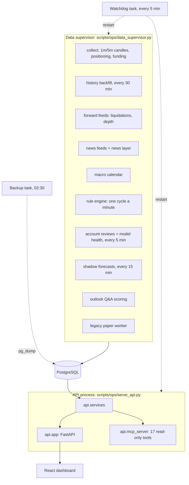

# Architecture

QuantPilot runs as two long-lived processes on one machine, around a PostgreSQL database. Both are started by `node scripts/start.cjs` and kept alive by the watchdog.

## One minute of the rule engine
1. `rules.live.cycle` pulls the latest 1-minute candles. At a fresh 15-minute close it also pulls mark and index prices (`fetch_marks`), so the premium feature is present.
2. `features.patterns` builds the causal snapshot. `rules.triggers` decides whether anything happened at all: a dump, a spike, an OI shock, a liquidation burst, a level event, a squeeze release, a trend pullback, a range edge, a macro release or a news shock.
3. `rules.rulebook` evaluates each playbook's conditions. `rules.arbiter` applies the gates (macro blackout, cascade halt, thin book, cooldown) and picks at most one action. `simulation.tradeplan` sets the stop, target and size, and checks reward:risk.
4. The reference `futures-v1` paper account steps its position (`simulation.futures`). Everything goes into the journal (`rules.journal`).
5. `accounts.live.step_all` passes the confirmed setups to the four A8 accounts:
   - `accounts.score` scores each setup;
   - `accounts.live.check_inputs` runs the model-health data check against the reference;
   - each account compares the score with its cutoff and records a decision (`accounts.journal`).

   An account pauses itself after 30 trades. Only the owner resumes it, through a loopback-only endpoint.

## Packages

| Package | Responsibility | Main dependencies |
|---|---|---|
| `data` | public archives, live REST, history backfill, forward feeds, repair, panels, macro calendar | `storage` |
| `features` | causal features, multi-timeframe context, rule-engine patterns, chart studies | `data` |
| `simulation` | event reducer, `futures-v1`, trade plans, outcomes, benchmark, legacy paper worker | `data`, `storage` |
| `research` | walk-forward, event studies, selective strategies, playbook research, forecaster | `features`, `simulation`, `data` |
| `rules` | rulebook, triggers, arbiter, live engine, journal, shadow layers | `features`, `simulation`, `research` |
| `accounts` | A8 config, score model, live fan-out, journal, reports, reviews | `rules`, `simulation`, `monitoring` |
| `monitoring` | model health, watchdog and backups, operations evidence, readiness | `accounts`, `rules`, `data` |
| `ai` | news ingestion and classification, news events, chat, MCP proxy | `storage` |
| `outlook` | market questions, validated answers, analogs, scoring | `research`, `ai` |
| `api` | shared read services, FastAPI app, MCP server | every package above |
| `storage` | database, market history, backups, snapshots | — |

The "main dependencies" column lists the core flow, not every import:
- `storage.database.initialize` imports every package that owns a table, so it can create them all at startup.
- The legacy paper worker and the readiness checks read through `api.services`.

## Design rules
- **Causal by construction.** Features use only bars completed before the decision cutoff. Leakage canaries in the test suite check this: a signal that peeks at the future must pass the research gate, and random or lagged signals must fail.
- **One reducer.** The same `futures-v1` reducer runs historical replays and live paper trading, so backtests and paper results share their accounting.
- **Pre-registration.** Every hypothesis is written down, with its date, in `docs/research/preregistration.md` before it is tested. The holdout year 2025-10-20 → 2026-10-19 is untouched.
- **No real orders.**
  - Only public market-data endpoints are called.
  - POST routes check that the client is this machine (`local_only`), and `scripts/verify/check-structure.cjs` enforces that.
  - MCP tools are read-only.
- **AI through subscriptions only.** `claude -p` runs with no tools, MCP servers, hooks or saved session. `ANTHROPIC_*`, `OPENAI_*` and similar keys are stripped from its environment, so nothing falls back to a billed API.
- **Monitoring never stops trading.** If the model-health reference is missing, or a check fails, the decision is still recorded. The failure itself is logged and shown.

## Storage
- PostgreSQL holds everything:
  - market history and live feeds (`storage.market`);
  - the rule-engine and account journals;
  - news and classifications;
  - forecasts, outlook answers and chat.
- Alembic migrations live in `migrations/`. Tables are also created idempotently at startup (`storage.database.initialize`).
- Models and research outputs live in `artifacts/`, and raw downloads in `data/`. Both are git-ignored.
