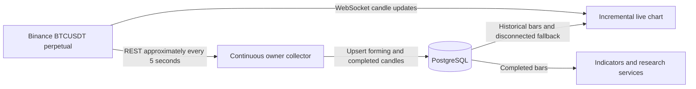

# BTCUSDT live chart and PostgreSQL persistence

The live chart uses **Binance USD-M BTCUSDT perpetuals**, matching the existing history, derivatives inputs and simulated portfolio. It loads historical candles from PostgreSQL and receives current candles directly from the exchange. Browser messages cannot write to the database or generate paper decisions.



| Operation | Cadence and behavior |
|---|---|
| Live candle and volume display | Apply each valid exchange message with `series.update`; the chart is not rebuilt for each tick. Binance documents updates every 250 ms when available. This is a provider cadence, not a measured network-latency promise. |
| PostgreSQL collection | Target five seconds plus request/commit time, independent of browser activity. Configure `QUANTPILOT_MARKET_POLL_SECONDS` between 1 and 60. |
| Persistence | Update the forming five-minute candle in place; keep completed candles with UTC event/availability/received timestamps and source. This stores candle snapshots rather than every individual trade. |
| Recovery | Paginate from the last completed candle after downtime. Retries deduplicate, older retries do not replace newer observations, and forming candles cannot overwrite completed bars. Empty/invalid provider responses retain existing data and report failure. |
| Stream recovery | Reconnect after close or ten seconds without valid messages; exponential delay is capped at 30 seconds. Reject other symbols, wrong intervals, malformed OHLC, stale/out-of-order events and attempts to reopen a closed streamed candle. |
| Disconnected chart | Retain the observation, label stream status explicitly and poll PostgreSQL every five seconds. |
| Studies and predictions | Studies refresh every fifteen seconds using completed candles. Forming stream bars are display data, not prediction features. |

The header distinguishes **Live** from **Stored**, and the inspector shows receipt/save times. Changing timeframes changes the subscribed stream; existing drawings and chart navigation remain available.

After updating an already-running installation, use the regular network-enabled terminal:

```powershell
node scripts/start.cjs --restart-services
```

Open [the chart workspace](http://localhost:5173/#chart), then optionally verify actual provider traffic and database advancement:

```powershell
node scripts/verify_live.cjs
```

The verifier uses installed Chrome by default (`QUANTPILOT_BROWSER_CHANNEL` can override it), reads the actual API, observes eight actual exchange messages, checks PostgreSQL receipt time advances and writes `docs/evidence/fast-live-runtime.json`. It exits 2 if either runtime check remains unverified. It never inserts fixture prices. Output includes the running collector's declared cadence; an absent cadence field indicates an older collector may still be loaded.

In this agent session, the real PostgreSQL observation advanced, but browser exchange connections returned `ERR_NETWORK_ACCESS_DENIED`. Actual WebSocket latency remains unverified here. Controlled browser tests verify incremental updates, chronological guards, fallback, reconnect and timeframe changes; separate database tests verify persistence and downtime recovery. Existing connected services were preserved because process termination approval is unavailable in this environment. The recorded collector now reports the five-second cadence; a further reload activates the new paper-run instrumentation and API endpoints.

The current local check passed **88 Python tests, 14 browser tests, seven PostgreSQL checks and the production build**. [Current evidence](evidence/local-readiness-verification.json) includes persistent worker monitoring and on-demand loading; [operations](operations.md) documents activation. The earlier [fast-live verification](evidence/fast-live-verification.json) and [runtime attempt](evidence/fast-live-runtime.json) remain historical evidence. The latest build has no oversized chunks. Actual browser WebSocket latency remains unverified under the agent network policy.

Sources: [Binance candle streams and 250 ms cadence](https://developers.binance.com/en/docs/catalog/core-trading-derivatives-trading-usd-s-m-futures/api/ws-streams/market), [TradingView incremental chart updates](https://tradingview.github.io/lightweight-charts/docs/api/interfaces/ISeriesApi#update).

The separate [persistence sample](evidence/persistence-runtime.json) reads actual PostgreSQL observations through the API without an exchange socket. Four saved receipt timestamps advanced at a median interval of 5.638 seconds; median local API request time was 159.5 ms. The price stayed unchanged during the sample. Run `node scripts/verify_persistence.cjs` to repeat the bounded observation; its measurements do not establish provider-to-browser latency.
